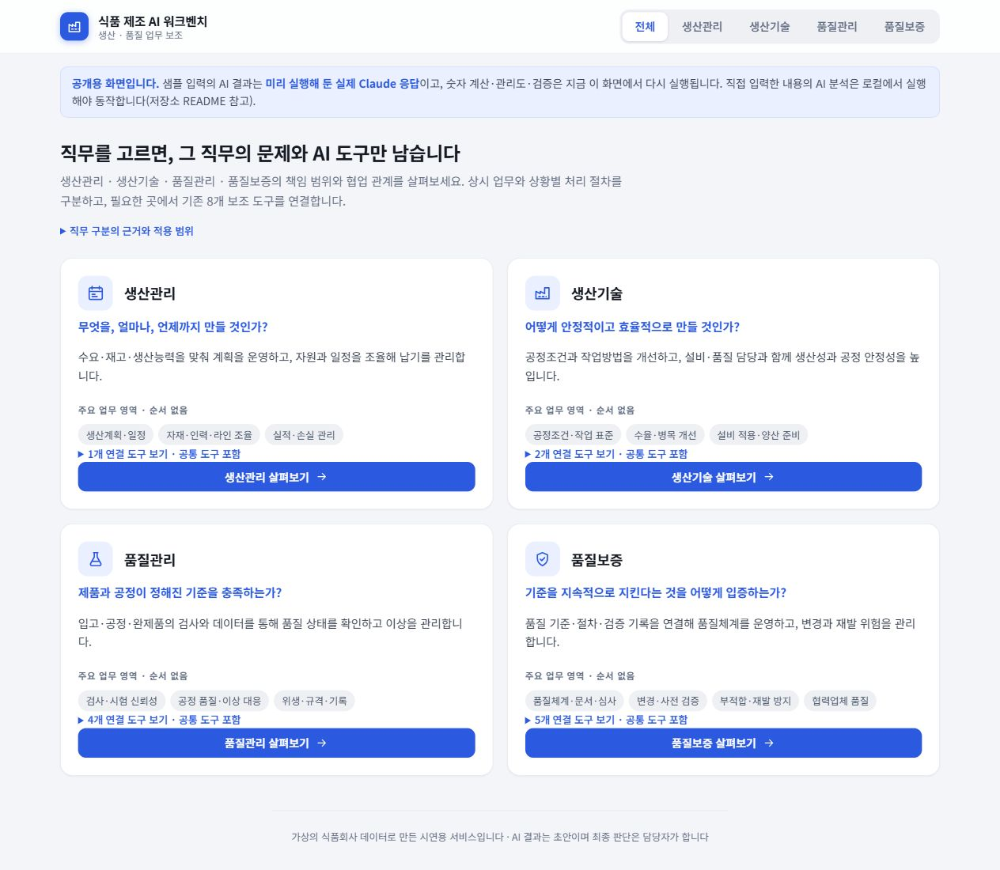
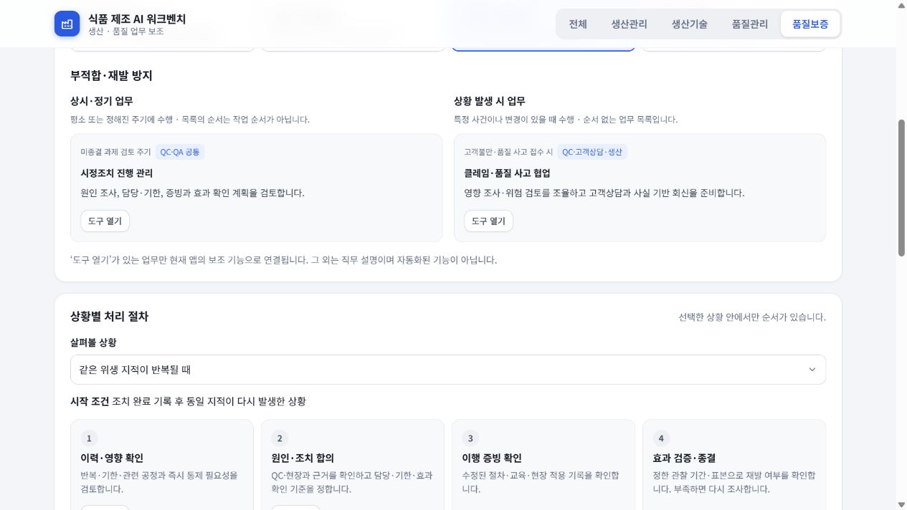
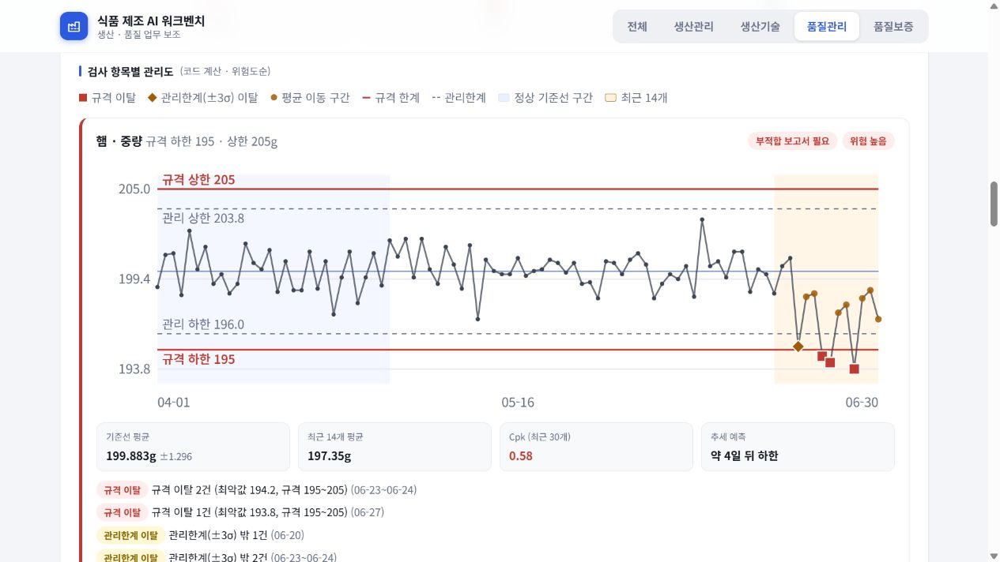
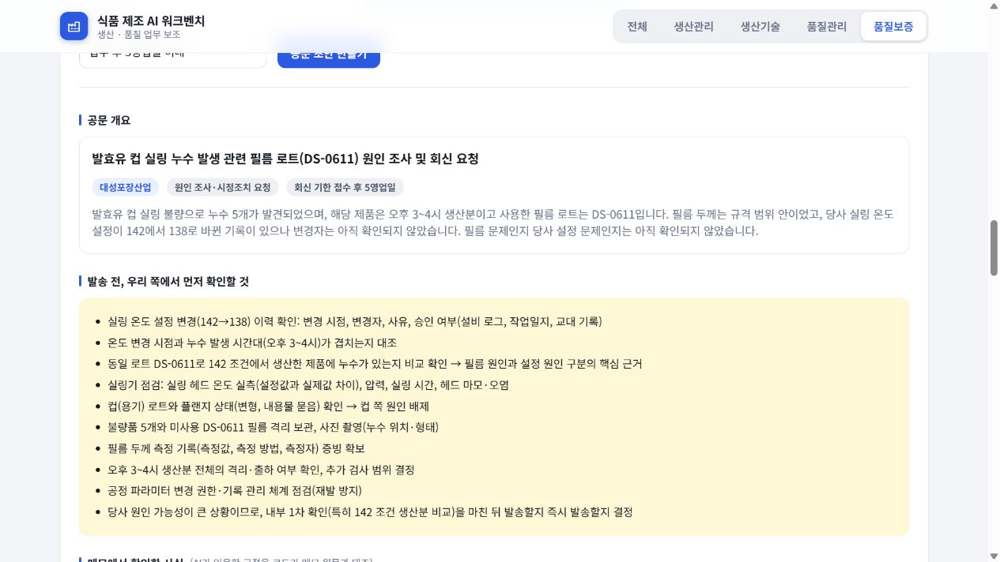

<div align="center">

# 식품 제조 AI 워크벤치

**생산·품질 업무의 반복 작업을, 근거를 확인할 수 있는 도구로.**<br>
생산관리 · 생산기술 · 품질관리 · 품질보증을 위한 직무 안내와 8가지 업무 보조 도구

`TypeScript · React · Vite` · `Hono` · `Zod · Vitest` · `Claude Agent SDK`

**[설치 없이 데모 열기 ↗](https://huijae1234.github.io/food-ai-workbench/)**

[화면과 기능](#화면으로-보는-주요-기능) · [도구 8종](#직무별-도구-8종) · [설계 의도](#핵심-설계-계산검증해석판단의-역할-분리) · [실행 방법](#실행-방법)

</div>



> **가상의 식품회사 데이터로 만든 개인 시연 프로젝트입니다.** 실제 회사의 데이터·시스템과 무관하며, 샘플 법규 조문도 가상입니다. 공개 데모의 샘플 AI 결과는 미리 실행해 둔 Claude 응답이며, 계산과 검증은 브라우저에서 다시 수행합니다.

## 왜 만들었나요?

식품 제조 업무에는 생산 실적을 취합하고, 검사 수치를 읽고, 부적합 메모를 보고서로 바꾸는 반복 작업이 있습니다. AI로 문서를 빠르게 만들더라도 **숫자가 틀리거나 원문에 없는 내용을 인용하면** 담당자가 다시 확인해야 합니다.

처음에는 채용공고를 출발점으로 업무 개선 후보를 골랐습니다. 현재는 **여러 공식 직무 자료를 비교해 네 직무의 중심 역할과 협업 관계를 재구성**했습니다. 그중 데이터가 있고 사람이 결과를 확인할 수 있는 업무를 도구로 구현했습니다.

[현재 직무 구분의 근거](analysis/03-role-guide.md) · [초기 업무 분석](analysis/01-tasks.md) · [초기 개선 후보](analysis/02-problems.md)

## 화면으로 보는 주요 기능

### 01. 내 직무를 선택하면 필요한 업무와 도구만 보기

첫 화면은 네 직무의 중심 질문과 책임 범위를 보여 줍니다. 직무를 선택하고 **주요 업무 영역**을 누르면, 해당 영역의 **상시·정기 업무**와 **상황 발생 시 업무**가 별도로 나타납니다. 이 목록에는 수행 순서가 없습니다.

| 직무 | 중심 질문 |
|---|---|
| 생산관리 | 무엇을, 얼마나, 언제까지 만들 것인가? |
| 생산기술 | 어떻게 안정적이고 효율적으로 만들 것인가? |
| 품질관리(QC) | 제품과 공정이 정해진 기준을 충족하는가? |
| 품질보증(QA) | 기준을 지속적으로 지킨다는 것을 어떻게 입증하는가? |

생산관리와 생산기술은 상하 관계로 두지 않았습니다. QC·QA의 부적합·위생·법규는 공통 업무로 표시하고, 같은 도구를 서로 다른 관점에서 사용할 수 있게 했습니다. 실제 업무 분장과 승인 권한은 회사마다 다릅니다.

### 상황이 생겼을 때만, 처리 순서 살펴보기



직무마다 두 가지씩, 총 **8개 상황별 처리 예시**를 제공합니다. 입고 지연, 수율 저하, 검사 규격 이탈, 반복 위생 지적처럼 시작 조건이 있는 사례에만 번호를 붙였습니다. 남길 결과와 협업 대상도 함께 안내합니다.

직무 설명 전체를 자동화한 앱은 아닙니다. **‘도구 열기’가 있는 항목만 기존 보조 기능으로 연결**되며 생산계획 편성, 변경 승인, 시정조치 종결 등의 판단·실행은 사람이 맡습니다. 사례는 실제 회사의 작업표준을 대신하지 않습니다.

### 02. 규격 안에 있어도, 서서히 나빠지는 변화 찾기



관리도·공정능력·평균 이동·추세는 **코드로 계산**합니다. 화면의 햄 중량 예시는 가상 검사 데이터에 심어 둔 이상으로, 최근 평균 하락과 규격 미달을 보여 줍니다. AI는 계산된 결과를 받아 의미·원인 가설·조치 방향을 설명합니다.

공정능력 지수(Cpk)는 측정값의 분포가 규격 안에 얼마나 안정적으로 들어오는지 보는 지표입니다. 화면의 추세 예상은 현재 흐름을 연장한 참고값이며, 실제 미래를 보장하는 예측이 아닙니다.

### 03. 문서 초안과 함께, 인용 근거도 확인하기



협력업체 통보서는 현장 메모와 업체 이력으로 초안을 만듭니다. **메모 인용은 원문과 대조**하고, 책임을 단정하는 표현은 경고합니다. 원인이 확정되지 않은 상황에서는 발송 전에 우리 쪽에서 확인할 사항도 따로 보여 줍니다.

## 직무별 도구 8종

| 직무 | 도구 | 입력 → 결과 |
|---|---|---|
| 생산관리·생산기술 공통 | 생산지표 분석·보고서 | 생산 실적 CSV → 지표·이상치 → 보고서 초안; 계획 자동 편성 아님 |
| 생산기술·설비보전 협업 | 설비 이상 진단 | 센서 변화 → 점검 가설·우선순위 초안; 현장 진단·정비 판단은 보전 담당과 협의 |
| 품질관리 | 검사 데이터 이상 탐지 | 검사 성적 → 관리도·공정능력·추세 → 이상 해석과 조치 제안 |
| QC·QA 공통 | 부적합 보고서 초안 | 현장 메모 → 표준 양식·5 Why·부족한 정보 질문 |
| QC·QA 공통 | 법규 개정 영향도 | 제공한 조문·품목 → 영향 품목과 조치 초안, 인용 대조; 자동 법규 수집 아님 |
| 품질보증 | 클레임 분류·회신 | 접수문 → 유형·심각도·조사 항목·회신 초안 |
| QC·QA 공통 | 위생점검 분석 | 점검 기록 → 반복 지적·기한 초과 집계 → 다음 점검 중점 |
| 품질보증 | 협력업체 통보서 | 상황 메모·업체 이력 → 공문 초안·확인 사항·표현 경고 |

## 핵심 설계: 계산·검증·해석·판단의 역할 분리

**업무 분류와 처리 순서를 구분했습니다.** 주요 업무 영역은 책임 범위, 상시·정기와 상황 발생 시 목록은 수행 시점, 처리 사례는 특정 상황의 순서를 설명합니다. 모든 업무를 하나의 순서로 강요하지 않습니다. 기존 8개 도구를 공통 직무에 연결한 것이며 도구 수를 부풀리지 않았습니다.

| 담당 | 맡기는 일 | 설계 이유 |
|---|---|---|
| **코드** | 수치 계산, 이상 탐지, 입력·응답 형식 검사, 인용 대조 | 같은 입력에 같은 기준을 적용하고 근거를 확인하기 위해 |
| **AI** | 계산 결과의 해석, 원인 가설, 질문과 문서 초안 | 비정형 메모를 정리하고 검토할 초안을 만들기 위해 |
| **사람** | 합격·보류·회수 판단, 공문 최종 검토와 발송 | 업무 맥락과 책임이 따르는 결정을 남기기 위해 |

- **원문에 없는 정보는 되묻습니다.** 메모에 없는 시각·수량·담당자를 채우지 않고 추가 확인 질문으로 돌려줍니다.
- **형식만 맞는 빈 응답도 걸러냅니다.** 필수 내용이 비거나 `placeholder`만 들어 있는 응답은 거절하고 재요청합니다.
- **계산 결과는 AI를 기다리지 않습니다.** 관리도 등은 먼저 보여 주고, AI 요청에는 경과 시간과 취소 기능을 제공합니다.
- **인용 일치와 사실의 진실성은 다릅니다.** 원문에 같은 글이 있다는 것까지 검사하며, 원문 자체가 맞는지나 해석이 적절한지는 사람이 확인해야 합니다.

## 어떻게 검증했나요?

샘플 데이터에는 찾아야 할 이상을 의도적으로 넣었습니다. [샘플 데이터 설명](sample-data/README.md)에서 생성 조건을 확인할 수 있습니다.

| 예시 | 넣어 둔 상황 | 살펴볼 결과 |
|---|---|---|
| 햄 중량 | 평균 하락과 규격 하한 미달 | 높은 위험도와 규격 이탈 표시 |
| 소시지 염도 | 규격 안에서 점진적으로 상승 | 평균 이동·추세 경고 |
| 우유 지방률 | 안정적인 흐름 | 현재 진행 중인 이상 없음 |

통계·도구 응답·인용 검사에는 자동 테스트를 두었습니다. 개발 중 발견한 인용문 앞의 조문 번호 처리 문제와 빈 응답 문제도 검사 규칙으로 반영했습니다.

```bash
cd app
npm test
npm run typecheck
```

## 실행 방법

### 가장 빠른 방법: 공개 데모

**[웹에서 바로 사용하기](https://huijae1234.github.io/food-ai-workbench/)**

직무를 선택하고 샘플 분석 버튼을 눌러 보세요. 설치와 로그인 없이 화면·계산·검증 결과를 확인할 수 있습니다.

| 실행 방식 | AI 결과 | 용도 |
|---|---|---|
| 공개 데모 / 정적 HTML | 샘플에 대해 미리 실행한 실제 Claude 응답 | 포트폴리오 탐색과 시연 |
| 로컬 일반 실행 | 인증된 로컬 Claude 연결로 새 요청 | 직접 입력한 내용 분석 |
| 로컬 `dev:demo` | 가짜 응답 | AI 연결 없이 개발·화면 점검 |

### 직접 입력한 내용을 분석하려면

로컬 실행은 Node.js와 Claude 인증 환경이 필요합니다. 인증 절차와 연결 조건은 [앱 실행 안내](app/README.md)를 확인하세요.

```bash
cd app
npm install
npm run dev:server
```

다른 터미널에서 화면을 실행합니다.

```bash
cd app
npm run dev:web
```

[http://localhost:5173](http://localhost:5173)을 엽니다. 로그인 없이 개발 화면을 볼 때는 `dev:server` 대신 `npm run dev:demo`를 실행합니다. 단일 HTML 제작은 `npm run build:artifact`를 사용합니다.

## 구조와 더 읽을 자료

```text
analysis/                    직무·업무 분석과 개선 후보
sample-data/                 가상 데이터와 생성 조건
app/src/server/domain/       통계·관리도·설비·위생점검 계산
app/src/server/application/  도구와 AI 요청 흐름
app/src/server/core.ts       공통 HTTP 앱
app/src/web/                 React 화면
app/src/static/              공개 데모용 기록 응답
```

[업무 분석](analysis/01-tasks.md) · [개선 후보 선정](analysis/02-problems.md) · [샘플 데이터](sample-data/README.md) · [개발·실행 안내](app/README.md)

## 직무 설명의 출처와 한계

[LS 직무소개](https://careers.lscablebiz.com/content/jobInfo/?locale=ko_KR), [O*NET 생산계획](https://www.onetonline.org/link/summary/43-5061.00)·[제조 엔지니어](https://www.onetonline.org/link/summary/17-2112.03), [ASQ QA·QC](https://asq.org/quality-resources/quality-assurance-vs-control), [오뚜기 직무소개](https://www.otoki.com/about/job-intro)를 비교했습니다. 자료별 반영 범위와 열람 한계는 [설계 기록](analysis/03-role-guide.md)에 남겼습니다. 검토일은 2026-10-16입니다.

업무·협업·처리 사례는 자료를 종합한 학습용 재구성이며 모든 회사의 조직도·권한·절차를 뜻하지 않습니다. 실제 공장 데이터로 성능을 검증하지 않았습니다. AI 결과는 초안이고 실제 규정 검토나 품질 판정을 대신하지 않습니다. 생성형 AI와 함께 기획·구현·개선한 개인 학습 프로젝트입니다.
